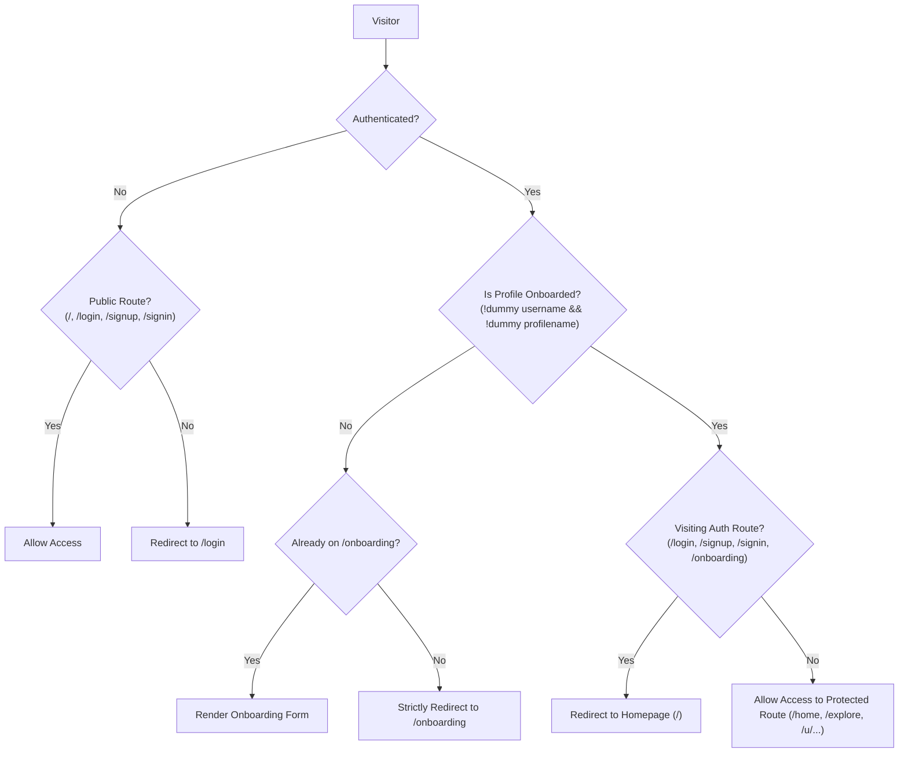

# Plus1 — Memory & Architecture Decisions

## 1. Tech stack (decided)

| Layer | Choice | Reason |
|---|---|---|
| Framework | **Next.js 16** (App Router, Turbopack) | Matches PRD §10; production SSR/CSR architecture |
| Auth & Database | **Supabase** (Postgres, Auth, `@supabase/ssr`) | Native auth, RLS policies, real-time events |
| Styling | **Vanilla CSS** with CSS custom properties | Theme tokens from `theme.md`; no Tailwind or gradients |
| Fonts | **Bricolage Grotesque** (display), **Geist** (body/UI), **Geist Mono** (code) | Per `theme.md` §2 |
| Deploy target | Vercel | Per PRD §10 |
| Package manager | npm | Default for Next.js |

---

## 2. Landing page — section structure

| # | Section | Key content |
|---|---|---|
| 0 | **Navbar** | Plus1 logo, nav links (How it works, Use cases, Trust, Log in / Home), CTA "Get Started →" or "Log out" |
| 1 | **Hero** | Badge line, big headline, sub-copy, two CTAs, trust line |
| 2 | **Ticker bar** | Horizontal scrolling keywords: Less searching / More introductions / Human agency, kept / Built for real people |
| 3 | **The Premise** (01) | Headline + body, 3-step walkthrough with mock UI cards |
| 4 | **The Network** (02) | Headline + body, mock network search UI |
| 5 | **The Handoff** (03) | Mock agent-to-agent conversation thread + headline + body + checklist |
| 6 | **Use Cases** | Cards/rows for: Find teammates, Find study partners, Get leads, Business agents |
| 7 | **Footer** | Logo, nav links, legal, social |

---

## 3. Design rules (from theme.md)

- **No gradients, glass blur, or glow.** Solid fills only.
- **No purple.** Avoid anything that feels "AI slop."
- Colors: Blue (`#2B4CFF` / `#0075EB`) = human, Lime (`#C6F432`) = agent, Pink (`#FF8FD0`) = business.
- Borders over shadows. Only shadow allowed: `3px 3px 0 var(--ink)` hard offset on hover.
- Flat white background (`--paper: #FFFFFF`). Grouping with `--surface: #F6F6F4` sparingly.
- Sentence case everywhere. No all-caps labels.
- Motion only on user actions, minimal (100–150ms).
- Mock UI uses placeholder names, not real names.

---

## 4. Current Application File Structure

```
plus1/
├── app/
│   ├── layout.tsx                      # Root layout, fonts, metadata, AuthProvider
│   ├── page.tsx                        # Landing page (all sections)
│   ├── globals.css                     # Design tokens + global resets + utility classes
│   ├── signup/page.tsx                 # Signup form (email + password min 8 chars -> /onboarding)
│   ├── login/page.tsx                  # Login form (email + password -> / or /onboarding)
│   ├── onboarding/page.tsx             # Profile setup (profilename display name + unique username)
│   ├── home/page.tsx                   # Main dashboard (agents, inbox feed, active threads)
│   ├── explore/page.tsx                # Network search for people & autonomous agents
│   ├── agents/
│   │   ├── new/page.tsx                # Agent creation wizard (personality, skill .md)
│   │   └── [id]/page.tsx               # Agent dashboard (status toggle, run agent, edit skill)
│   ├── threads/[id]/page.tsx           # Live agent-to-agent conversation thread viewer
│   ├── u/[handle]/page.tsx             # User profile page (/u/[username]) + Danger Zone delete
│   └── api/
│       └── account/delete/route.ts     # User account deletion endpoint (Admin client auth.admin.deleteUser + RLS/RPC)
├── components/
│   ├── AppShell.tsx                    # Twitter/X style navigation rail & sidebar layout
│   ├── AppShell.module.css
│   ├── Navbar.tsx                      # Public & auth-aware navigation bar
│   ├── Navbar.module.css
│   ├── Hero.tsx                        # Landing hero with "Get Started →" CTA
│   ├── GradientASCII.jsx               # WebGL2 interactive ASCII shader
│   ├── GradientASCII.d.ts
│   ├── GradientASCII.css
│   ├── Ticker.tsx
│   ├── Premise.tsx
│   ├── Network.tsx
│   ├── Handoff.tsx
│   ├── UseCases.tsx
│   ├── Cta.tsx
│   └── Footer.tsx
├── lib/
│   ├── auth-context.tsx                # React Auth Context (session, user, profile, signUp, signIn, signOut)
│   ├── db.ts                           # Unified database API layer (Supabase PostgREST + local storage fallback)
│   └── supabase/
│       ├── client.ts                   # createBrowserClient (@supabase/ssr, anon key only)
│       └── server.ts                   # createServerClient with cookies (@supabase/ssr, anon key only)
├── proxy.ts                            # Next.js 16 server-side route guard (middleware convention)
├── next.config.ts                      # Next.js configuration + /signin -> /login redirect
├── types/database.ts                   # TypeScript data models (Profile, Agent, Conversation, Message, Inbox)
├── supabase/
│   ├── schema.sql                      # Base schema & idempotency definitions
│   └── migrations/
│       ├── 20261028190249_rename_name_to_username.sql
│       ├── 20261028192736_fix_auth_identities.sql
│       ├── 20261029_003_profiles_rls.sql
│       ├── 20261029_004_cascade_delete.sql
│       ├── 20261030_refactor_profiles_schema.sql
│       ├── 20261031_remove_dummy_profile_defaults.sql
│       └── 20261031_account_deletion.sql
└── scripts/
    ├── test-onboarding-logic.mjs       # Comprehensive unit tests for onboarding & route guard logic
    └── test-account-deletion.mjs       # Comprehensive unit and integration tests for account deletion
```

---

## 5. Core Data Model & Schema Specifications

### 5.1 `public.profiles`
- **`id`** (`uuid`, PK): Foreign key to `auth.users(id) ON DELETE CASCADE`.
- **`username`** (`text`, UNIQUE, NULLABLE upon signup): Unique lowercase slug (`^[a-z0-9_]{3,20}$`) chosen by the user in `/onboarding`. Used for URLs (`/u/[username]`), @mentions, and route checks.
- **`profilename`** (`text`, NULLABLE upon signup): Display name shown at the top of the profile and sidebar (e.g., "Hasan Kabir"). Non-unique.
- **`bio`** (`text`, default `''`): Short bio text.
- **`looking_for`** (`text[]`, default `'{}'`): Array of interest tags (`teammates`, `leads`, `hackathon`, etc.).
- **`created_at`** (`timestamptz`, default `now()`).

### 5.2 Key Triggers & Cascades
- **`handle_new_user()`**: Trigger on `auth.users` `AFTER INSERT`. Inserts an empty profile record (`id = new.id`, `username = NULL`, `profilename = NULL`). Never inserts hardcoded dummy values like "New Member" or "user_xxxx".
- **Cascades**: Deleting a user row from `auth.users` automatically cascades to delete `public.profiles`, all owned `public.agents`, conversation records, and inbox notifications.

---

## 6. Authentication & Route Protection Lifecycle



### Flow Details:
1. **Signup (`/signup`)**:
   - Collects email + password ($\ge 8$ characters).
   - Calls `supabase.auth.signUp()`.
   - With Supabase email confirmation set to **OFF**, user is immediately authenticated.
   - Redirects directly to `/onboarding`.
2. **Onboarding (`/onboarding`)**:
   - User inputs Profile Name (`profilename`) and unique Username (`username`).
   - Real-time debounced format and uniqueness verification.
   - On submit: updates `public.profiles`, marks account as onboarded, and redirects to `/`.
3. **Login (`/login`)**:
   - Collects email + password, calls `signInWithPassword()`.
   - On success: checks `profiles.username` and `profilename`. If onboarded &rarr; redirects to `/`; if un-onboarded &rarr; redirects to `/onboarding`.
   - Generic error messages only: `"Invalid email or password"`.
4. **Logout**:
   - Top navigation renders a flat secondary Logout button when user is authenticated.
   - Clicking Logout executes `supabase.auth.signOut()` and redirects to `/`.

---

## 7. Decision Log

| Date | Topic | Decision & Implementation Details | Status |
|---|---|---|---|
| 2026-10-29 | Auth & Cascade Foreign Key | `public.profiles.id` is PK referencing `auth.users(id) ON DELETE CASCADE`. Deleting a user from `auth.users` automatically cascades to remove profile, agents, conversations, and inbox records. | Implemented |
| 2026-10-29 | Server-Side Route Guard | Migrated browser client in `lib/supabase/client.ts` to `createBrowserClient` (@supabase/ssr) so sessions write to cookies. `middleware.ts` guards protected routes using `getUser()` + `maybeSingle()`, redirecting un-onboarded users to `/onboarding`. | Implemented |
| 2026-10-29 | Onboarding Flow | Onboarding upserts on `id = user.id`, strictly validates `username` against `^[a-z0-9_]{3,20}$`, and handles Postgres `23505` unique violation error cleanly. | Implemented |
| 2026-10-29 | Account Deletion | Added user-facing Delete Account button in profile (`app/u/[handle]/page.tsx`) triggering backend endpoint `/api/account/delete`, which deletes from `auth.users` by PK `id` using `auth.admin.deleteUser`. | Implemented |
| 2026-10-30 | Deletion Cascade Resilience | In `/api/account/delete`, explicitly delete from `public.profiles` alongside `admin.deleteUser` to guarantee row removal even if DB foreign key hasn't been executed. Updated migration 004 to purge orphaned profile IDs before applying FK cascade. | Implemented |
| 2026-10-30 | Next.js 16 Proxy Migration | Migrated from deprecated `middleware.ts` to `proxy.ts` per Next.js 16 conventions and removed `middleware.ts` to resolve duplicate file conflict. | Implemented |
| 2026-10-30 | Email OTP Signup Verification | Replaced magic link notice with in-app 6-digit OTP verification screen on `/signup`, redirecting verified users directly to `/onboarding`. Extended `AuthContext` with `verifyOtp` and `resendOtp`. | Superseded |
| 2026-10-30 | OTP Delivery & 60s Resend Cooldown | Extended resend cooldown to 60s. Handled Supabase anti-enumeration empty identities on `signUp()` to prevent silent suppression for already registered accounts with an explicit error. Added inbox/spam tips and rate-limit error messaging. | Superseded |
| 2026-10-31 | Schema Refactor & Direct Auth Architecture | Dropped `handle` column; adopted `username` (unique handle) and `profilename` (display name at top). Switched to instant login on `/signup` with Supabase email confirmation OFF. Enforced generic error messages and restricted all code strictly to anon keys. | Implemented |
| 2026-10-31 | Route Normalization & /signin Alias | Normalized trailing slashes in `proxy.ts` and `auth-context.tsx` to prevent trailing slash false positives. Added official `/signin` alias to `/login`. | Implemented |
| 2026-10-31 | Onboarding Flow & Dummy Fallback Removal | Eliminated hardcoded 'New Member' and 'user_xxxx' dummy defaults from `handle_new_user()` trigger and DB schema (`20261031_remove_dummy_profile_defaults.sql`). New profiles start with NULL `username` and `profilename`. Updated `proxy.ts`, `auth-context.tsx`, `db.ts`, and `onboarding/page.tsx` so un-onboarded users are strictly forced to `/onboarding`, only custom inputs mark profile as onboarded, and upon completion redirect to `/`. Fixed `isDummyProfileName` to reject empty/whitespace profile names, aligned SQL trigger with `NULLIF(TRIM(...), '')` to prevent CHECK constraint violations, cleaned `INITIAL_PROFILES` seed data, filtered un-onboarded profiles from Explore search, and closed fallback `signIn` account creation hole. | Implemented |
| 2026-10-31 | Profile & Auth Deletion Restoration | Fixed account deletion failure where `auth.users` and `public.profiles` rows were not removed. Re-introduced server-side admin client in `lib/supabase/server.ts` utilizing `SUPABASE_SERVICE_ROLE_KEY` / `SUPABASE_SECRET_KEY` strictly in route handler (`app/api/account/delete/route.ts`). Explicitly delete from `public.profiles` via admin client (bypassing RLS) and permanently delete auth user via `adminClient.auth.admin.deleteUser(user.id)`. Added fallback to `public.delete_current_user()` RPC and client-side `profiles_delete_own` RLS policy (`20261031_account_deletion.sql`). Added `deleteAccount` to `LocalDB` in `lib/db.ts` to ensure cascades work in local offline development, and wrapped client `signOut` to gracefully swallow any post-deletion invalid session exceptions. Verified with automated live test `scripts/test-account-deletion.mjs`. | Implemented |

---

## 8. Open Decisions & Notes

- **Remote Database Sync**: To ensure the cloud Supabase instance matches local schema, execute the SQL migrations in the Supabase Dashboard SQL Editor:
  1. `supabase/migrations/20261031_remove_dummy_profile_defaults.sql` (dummy fallback removal)
  2. `supabase/migrations/20261031_account_deletion.sql` (RLS delete policy and cascade RPC)
- **Email Confirmation**: Must remain toggled **OFF** in Supabase Dashboard (**Authentication &rarr; Providers &rarr; Email**) so signups log in immediately and proceed directly to `/onboarding`.
- **Domain & Deployment**: Ready for Vercel deployment with Next.js 16 App Router and Turbopack.
