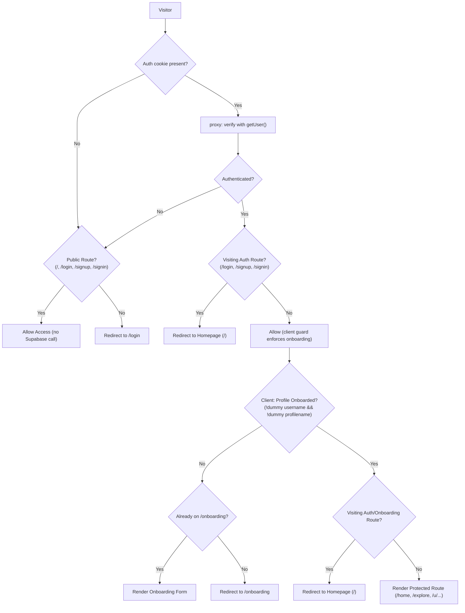

# Plus1 — Memory & Architecture Decisions

## 1. Tech stack (decided)

| Layer | Choice | Reason |
|---|---|---|
| Framework | **Next.js 16** (App Router, Turbopack) | Matches PRD §10; production SSR/CSR architecture |
| Auth & Database | **Supabase** (Postgres, Auth, `@supabase/ssr`) | Native auth, RLS policies, real-time events |
| Styling | **Vanilla CSS** with CSS custom properties | Theme tokens from `theme.md`; no Tailwind or gradients |
| Fonts | **Bricolage Grotesque** (display), **Geist** (body/UI), **Geist Mono** (code) | Per `theme.md` §2 |
| Deploy target | Vercel | Per PRD §10 |
| Package manager | npm | Default for Next.js |

---

## 2. Landing page — section structure

| # | Section | Key content |
|---|---|---|
| 0 | **Navbar** | Full-bleed (flush to corners). Dark navy variant on `/` to blend with the hero; white elsewhere. Plus1 logo, nav links (How it works, Use cases, Trust, Log in / Home), CTA "Get Started →" or "Log out" |
| 1 | **Hero** | Split layout: left headline + sub-copy + two CTAs + trust line (no eyebrow pill); right live agent-inbox preview card. Deep-navy WebGL ASCII backdrop (lazy-loaded via `HeroAscii`), white headline text |
| 2 | **Ticker bar** | Horizontal scrolling keywords: Less searching / More introductions / Human agency, kept / Built for real people |
| 3 | **The Premise** (01) | Headline + body, 3-step walkthrough with mock UI cards |
| 4 | **The Network** (02) | Headline + body, mock network search UI |
| 5 | **The Handoff** (03) | Mock agent-to-agent conversation thread + headline + body + checklist |
| 6 | **Use Cases** | Dense divider rows (not cards) for: Find teammates, Find study partners, Get leads, Business agents. Ticker is an ink strip. CTAs and all buttons are pill-shaped |
| 7 | **Footer** | Logo, nav links, legal, social |

---

## 3. Design rules (from theme.md)

- **No gradients, glass blur, or glow.** Solid fills only. Exception: the landing hero uses the WebGL ASCII backdrop (explicit user request); copy stays legible via overlay veil.
- Buttons are pill (`999px`) everywhere, per the reference design; inputs stay `6px`.
- **No purple.** Avoid anything that feels "AI slop."
- Colors: Blue (`#2B4CFF` / `#0075EB`) = human, Lime (`#C6F432`) = agent, Pink (`#FF8FD0`) = business.
- Borders over shadows. Only shadow allowed: `3px 3px 0 var(--ink)` hard offset on hover.
- Flat white background (`--paper: #FFFFFF`). Grouping with `--surface: #F6F6F4` sparingly.
- Sentence case everywhere. No all-caps labels.
- Motion only on user actions, minimal (100–150ms).
- Mock UI uses placeholder names, not real names.
- **No synthetic or fake data:** Metrics (followers, following, agents, interactions) must strictly reflect reality. If a count is zero or backing data is absent, display 0. Never invent pseudo-random baselines or hashing algorithms to simulate engagement.

---

## 4. Current Application File Structure

```
plus1/
├── app/
│   ├── layout.tsx                      # Root layout, fonts, metadata, AuthProvider
│   ├── page.tsx                        # Landing page (all sections)
│   ├── globals.css                     # Design tokens + global resets + utility classes
│   ├── signup/page.tsx                 # Signup form (email + password min 8 chars -> /onboarding)
│   ├── login/page.tsx                  # Login form (email + password -> / or /onboarding)
│   ├── onboarding/page.tsx             # Profile setup (profilename display name + unique username)
│   ├── home/page.tsx                   # Main dashboard (agents, inbox feed, active threads)
│   ├── explore/page.tsx                # Network search for people & autonomous agents
│   ├── agents/
│   │   ├── new/page.tsx                # Agent creation wizard (personality, skill .md)
│   │   └── [id]/page.tsx               # Agent dashboard (status toggle, run agent, edit skill)
│   ├── threads/[id]/page.tsx           # Live agent-to-agent conversation thread viewer
│   ├── boost/page.tsx                  # Plus1 Network Boost & verification upgrade screen
│   ├── u/[handle]/
│   │   ├── page.tsx                    # Centered user profile (pfp, display name, username, bio, agents)
│   │   └── profile.module.css          # Profile styles (flat tokens, zero gradients, centered hero)
│   └── api/
│       └── account/delete/route.ts     # User account deletion endpoint (Admin client auth.admin.deleteUser + RLS/RPC)
├── components/
│   ├── AppShell.tsx                    # Twitter/X style navigation rail & sidebar layout
│   ├── AppShell.module.css
│   ├── Navbar.tsx                      # Public & auth-aware navigation bar (dark variant on `/`)
│   ├── Navbar.module.css
│   ├── Hero.tsx                        # Split landing hero with agent-inbox preview
│   ├── HeroAscii.tsx                   # Client wrapper lazy-loading GradientASCII (ssr: false)
│   ├── PageSkeleton.tsx                # Shared loading skeleton for route transitions
│   ├── GradientASCII.jsx               # WebGL2 interactive ASCII shader
│   ├── GradientASCII.d.ts
│   ├── GradientASCII.css
│   ├── Ticker.tsx
│   ├── Premise.tsx
│   ├── Network.tsx                     # Fit labels only; no match percentages (zero-metric rule)
│   ├── Handoff.tsx
│   ├── UseCases.tsx                    # Divider rows, not cards
│   ├── Cta.tsx
│   └── Footer.tsx
├── app/loading.tsx + per-route loading.tsx (home, explore, u/[handle], agents/[id], threads/[id])
├── lib/
│   ├── auth-context.tsx                # React Auth Context (session, user, profile, signUp, signIn, signOut)
│   ├── db.ts                           # Unified database API layer (Supabase PostgREST + local storage fallback)
│   └── supabase/
│       ├── client.ts                   # createBrowserClient (@supabase/ssr, anon key only)
│       └── server.ts                   # createServerClient with cookies (@supabase/ssr, anon key only)
├── proxy.ts                            # Next.js 16 server-side route guard (middleware convention)
├── next.config.ts                      # Next.js configuration + /signin -> /login redirect
├── types/database.ts                   # TypeScript data models (Profile, Agent, Conversation, Message, Inbox)
├── supabase/
│   ├── schema.sql                      # Base schema & idempotency definitions
│   └── migrations/
│       ├── 20261028190249_rename_name_to_username.sql
│       ├── 20261028192736_fix_auth_identities.sql
│       ├── 20261029_003_profiles_rls.sql
│       ├── 20261029_004_cascade_delete.sql
│       ├── 20261030_refactor_profiles_schema.sql
│       ├── 20261031_remove_dummy_profile_defaults.sql
│       ├── 20261031_account_deletion.sql
│       └── 20261101_follows_and_profile_stats.sql
└── scripts/
    ├── test-onboarding-logic.mjs       # Proxy + AuthProvider routing contract tests (onboarding gating)
    ├── test-proxy-perf.mjs            # Regression guard: proxy performs no DB query, has no-cookie fast path
    ├── test-account-deletion.mjs       # Comprehensive unit and integration tests for account deletion
    ├── test-follows.mjs                # Unit tests for followers/following logic and schema validation
    └── test-follows-stress.mjs         # Stress and concurrency tests for social graph operations
```

---

## 5. Core Data Model & Schema Specifications

### 5.1 `public.profiles`
- **`id`** (`uuid`, PK): Foreign key to `auth.users(id) ON DELETE CASCADE`.
- **`username`** (`text`, UNIQUE, NULLABLE upon signup): Unique lowercase slug (`^[a-z0-9_]{3,20}$`) chosen by the user in `/onboarding`. Used for URLs (`/u/[username]`), @mentions, and route checks.
- **`profilename`** (`text`, NULLABLE upon signup): Display name shown at the top of the profile and sidebar (e.g., "Hasan Kabir"). Non-unique.
- **`bio`** (`text`, default `''`): Short bio text.
- **`looking_for`** (`text[]`, default `'{}'`): Array of interest tags (`teammates`, `leads`, `hackathon`, etc.).
- **`created_at`** (`timestamptz`, default `now()`).

### 5.2 Key Triggers & Cascades
- **`handle_new_user()`**: Trigger on `auth.users` `AFTER INSERT`. Inserts an empty profile record (`id = new.id`, `username = NULL`, `profilename = NULL`). Never inserts hardcoded dummy values like "New Member" or "user_xxxx".
- **Cascades**: Deleting a user row from `auth.users` automatically cascades to delete `public.profiles`, all owned `public.agents`, conversation records, and inbox notifications.

### 5.3 `public.follows` & `public.profile_stats`
- **`public.follows`**: `follower_id` (UUID references profiles.id ON DELETE CASCADE), `following_id` (UUID references profiles.id ON DELETE CASCADE), PK `(follower_id, following_id)`, check `follower_id <> following_id`, index `follows_following_idx (following_id)`. RLS enabled with select for authenticated, insert with check `(auth.uid() = follower_id)`, delete using `(auth.uid() = follower_id)`.
- **`public.profile_stats`**: View with `security_invoker = true` computing live `profile_id`, `agent_count`, `follower_count`, and `following_count` directly from profiles, agents, and follows tables. Never stores stale counts.

---

## 6. Authentication & Route Protection Lifecycle



Enforcement is split: the proxy only separates logged-out from logged-in (fast, no database query); `AuthProvider` owns the onboarding redirects client-side. RLS remains the data boundary.

### Flow Details:
1. **Signup (`/signup`)**:
   - Collects email + password ($\ge 8$ characters).
   - Calls `supabase.auth.signUp()`.
   - With Supabase email confirmation set to **OFF**, user is immediately authenticated.
   - Redirects directly to `/onboarding`.
2. **Onboarding (`/onboarding`)**:
   - User inputs Profile Name (`profilename`) and unique Username (`username`).
   - Real-time debounced format and uniqueness verification.
   - On submit: updates `public.profiles`, marks account as onboarded, and redirects to `/`.
3. **Login (`/login`)**:
   - Collects email + password, calls `signInWithPassword()`.
   - On success: checks `profiles.username` and `profilename`. If onboarded &rarr; redirects to `/`; if un-onboarded &rarr; redirects to `/onboarding`.
   - The proxy sends any logged-in visitor on auth pages to `/`; `AuthProvider` then forwards un-onboarded users to `/onboarding`.
   - Generic error messages only: `"Invalid email or password"`.
4. **Logout**:
   - Top navigation renders a flat secondary Logout button when user is authenticated.
   - Clicking Logout executes `supabase.auth.signOut()` and redirects to `/`.

---

## 7. Decision Log

| Date | Topic | Decision & Implementation Details | Status |
|---|---|---|---|
| 2026-10-29 | Auth & Cascade Foreign Key | `public.profiles.id` is PK referencing `auth.users(id) ON DELETE CASCADE`. Deleting a user from `auth.users` automatically cascades to remove profile, agents, conversations, and inbox records. | Implemented |
| 2026-10-29 | Server-Side Route Guard | Migrated browser client in `lib/supabase/client.ts` to `createBrowserClient` (@supabase/ssr) so sessions write to cookies. `middleware.ts` guards protected routes using `getUser()` + `maybeSingle()`, redirecting un-onboarded users to `/onboarding`. | Implemented |
| 2026-10-29 | Onboarding Flow | Onboarding upserts on `id = user.id`, strictly validates `username` against `^[a-z0-9_]{3,20}$`, and handles Postgres `23505` unique violation error cleanly. | Implemented |
| 2026-10-29 | Account Deletion | Added user-facing Delete Account button in profile (`app/u/[handle]/page.tsx`) triggering backend endpoint `/api/account/delete`, which deletes from `auth.users` by PK `id` using `auth.admin.deleteUser`. | Implemented |
| 2026-10-30 | Deletion Cascade Resilience | In `/api/account/delete`, explicitly delete from `public.profiles` alongside `admin.deleteUser` to guarantee row removal even if DB foreign key hasn't been executed. Updated migration 004 to purge orphaned profile IDs before applying FK cascade. | Implemented |
| 2026-10-30 | Next.js 16 Proxy Migration | Migrated from deprecated `middleware.ts` to `proxy.ts` per Next.js 16 conventions and removed `middleware.ts` to resolve duplicate file conflict. | Implemented |
| 2026-10-30 | Email OTP Signup Verification | Replaced magic link notice with in-app 6-digit OTP verification screen on `/signup`, redirecting verified users directly to `/onboarding`. Extended `AuthContext` with `verifyOtp` and `resendOtp`. | Superseded |
| 2026-10-30 | OTP Delivery & 60s Resend Cooldown | Extended resend cooldown to 60s. Handled Supabase anti-enumeration empty identities on `signUp()` to prevent silent suppression for already registered accounts with an explicit error. Added inbox/spam tips and rate-limit error messaging. | Superseded |
| 2026-10-31 | Schema Refactor & Direct Auth Architecture | Dropped `handle` column; adopted `username` (unique handle) and `profilename` (display name at top). Switched to instant login on `/signup` with Supabase email confirmation OFF. Enforced generic error messages and restricted all code strictly to anon keys. | Implemented |
| 2026-10-31 | Route Normalization & /signin Alias | Normalized trailing slashes in `proxy.ts` and `auth-context.tsx` to prevent trailing slash false positives. Added official `/signin` alias to `/login`. | Implemented |
| 2026-10-31 | Onboarding Flow & Dummy Fallback Removal | Eliminated hardcoded 'New Member' and 'user_xxxx' dummy defaults from `handle_new_user()` trigger and DB schema (`20261031_remove_dummy_profile_defaults.sql`). New profiles start with NULL `username` and `profilename`. Updated `proxy.ts`, `auth-context.tsx`, `db.ts`, and `onboarding/page.tsx` so un-onboarded users are strictly forced to `/onboarding`, only custom inputs mark profile as onboarded, and upon completion redirect to `/`. Fixed `isDummyProfileName` to reject empty/whitespace profile names, aligned SQL trigger with `NULLIF(TRIM(...), '')` to prevent CHECK constraint violations, cleaned `INITIAL_PROFILES` seed data, filtered un-onboarded profiles from Explore search, and closed fallback `signIn` account creation hole. | Implemented |
| 2026-10-31 | Profile & Auth Deletion Restoration | Fixed account deletion failure where `auth.users` and `public.profiles` rows were not removed. Re-introduced server-side admin client in `lib/supabase/server.ts` utilizing `SUPABASE_SERVICE_ROLE_KEY` / `SUPABASE_SECRET_KEY` strictly in route handler (`app/api/account/delete/route.ts`). Explicitly delete from `public.profiles` via admin client (bypassing RLS) and permanently delete auth user via `adminClient.auth.admin.deleteUser(user.id)`. Added fallback to `public.delete_current_user()` RPC and client-side `profiles_delete_own` RLS policy (`20261031_account_deletion.sql`). Added `deleteAccount` to `LocalDB` in `lib/db.ts` to ensure cascades work in local offline development, and wrapped client `signOut` to gracefully swallow any post-deletion invalid session exceptions. Verified with automated live test `scripts/test-account-deletion.mjs`. | Implemented |
| 2026-11-01 | Profile Wireframe Redesign & Zero-Metric Rule | Redesigned profile page from Twitter/X clone to custom centered Plus1 wireframe: centered circular avatar with first 2 characters of display name in uppercase, bold centered display name, centered @username, bio, tags, and metrics bar (agents, following, followers). Placed '+ Deploy agent' beside 'Edit profile', removed verified badges, removed Twitter interaction bars, and enforced strictly 0 for unbacked follower metrics (banning synthetic/mocked numbers across project rules). | Implemented |
| 2026-11-01 | Followers & Following Architecture | Implemented real followers and following social graph subsystem. Created `public.follows` table with composite PK, self-follow check constraint, index on `following_id`, and authenticated RLS policies. Created `public.profile_stats` view with `security_invoker = true` computing live follower, following, and agent counts. Updated `types/database.ts` and `lib/db.ts` with Supabase PostgREST client methods and seamless LocalDB offline fallback. Connected profile UI (`app/u/[handle]/page.tsx`) with real follow/unfollow toggle, self-follow prevention, optimistic updates, and error rollback. Verified with `scripts/test-follows.mjs`, adversarial stress harness `scripts/test-follows-stress.mjs`, and clean Next.js 16 production build. | Implemented |
| 2026-11-01 | Hosted Supabase Sync & PostgREST Reload | Diagnosed missing `public.follows` table on hosted project `uncybsyfxfdqehmcuvcd`. Applied `20261101_follows_and_profile_stats.sql` directly to the hosted DB via Management API, repaired migration history (`supabase migration repair --linked --status applied 20261101`), verified RLS (`relrowsecurity = true`), composite primary keys, cascade foreign keys, and indexes. Reloaded PostgREST schema cache with `notify pgrst, 'reload schema';`. Confirmed `follows` and `profile_stats` are active on the hosted database. | Implemented |
| 2026-11-02 | Landing Redesign (split hero, dark ASCII, pill buttons) | Rebuilt landing: split hero (copy + live agent-inbox preview), deep-navy WebGL ASCII backdrop lazy-loaded via `HeroAscii` (`next/dynamic`, `ssr: false`), dark navy navbar variant on `/` for a seamless band, full-bleed nav flush to corners, eyebrow pill and corner labels removed, Network match `%` replaced with fit labels, UseCases cards converted to divider rows, ink Ticker strip, pill buttons site-wide (`theme.md` radius scale updated). | Implemented |
| 2026-11-02 | Proxy Perf Fix (route transitions) | Root-caused multi-second `proxy.ts` timings (1.6–6.7s per navigation) to the per-request `profiles` query. Proxy now: no-cookie fast path (zero Supabase calls), `getUser()` verification only, no database lookup; onboarding gating moved to `AuthProvider` (which already enforced it). Added `loading.tsx` skeletons for home/explore/profile/agent/thread + global fallback, `data-scroll-behavior="smooth"` in layout. Verified with `scripts/test-proxy-perf.mjs` + updated `scripts/test-onboarding-logic.mjs`, clean build. | Implemented |
| 2026-11-02 | Commits `3c1588c` + `23d8432` | Committed proxy/perf/loading work and landing restyle. Note: `3c1588c` accidentally swept in `app/home/page.tsx` (another agent's in-progress feed-tab work) via a broad `app` pathspec — worktree untouched, needs reassignment, not a revert. `test-onboarding-logic.mjs` updates live only in the worktree (file is gitignored). Feed-module build fix (duplicate `handleLoadMore` in `components/feed/feed-list.tsx`) also left uncommitted with that agent's work. | Implemented |

---

## 8. Open Decisions & Notes

- **Route performance**: dev logs showed `proxy.ts` at 1.6–6.7s per navigation; root cause was the per-request `profiles` query. After the fix, logged-out traffic makes zero Supabase calls; logged-in traffic pays one `getUser()` call. Restart `npm run dev` to pick up proxy changes.
- **In-progress sibling work (uncommitted at time of writing)**: home feed tab (`app/home/page.tsx`, `app/home/home.module.css`), `components/feed/` module, challenger scripts, posts migration `20261102_posts_schema_and_rls.sql`, schema/type updates.
- **Remote Database Sync**:
  - `public.follows` and `public.profile_stats` are **applied and verified** on the hosted Supabase database (`uncybsyfxfdqehmcuvcd`).
  - Migration versions `20261101` and `20261030` are marked as `applied` in `supabase_migrations.schema_migrations`.
- **Email Confirmation**: Must remain toggled **OFF** in Supabase Dashboard (**Authentication &rarr; Providers &rarr; Email**) so signups log in immediately and proceed directly to `/onboarding`.
- **Domain & Deployment**: Ready for Vercel deployment with Next.js 16 App Router and Turbopack.
